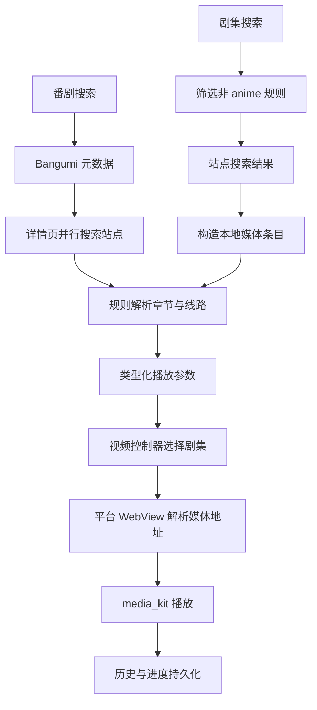

# Kazumi 项目导学与分支分析

分析日期：2026-10-09。代码快照：`feat/drama-olevod` / `72925bc5f44ac0b3d0a70b0a9d2295820ba577d0`。

本地分支已跟踪 `origin/feat/drama-olevod`。切换前工作区干净。以当前本地 `origin/main` 引用为基线，分支领先 1 个提交、落后 0 个提交，差异为 5 个文件、316 行新增、4 行删除；本次只获取了目标远端分支，未刷新远端 main。本文是源码分析，不代表完成了运行时验收，也不将上游成果认定为用户个人贡献。

## 1. 前置知识（面试高频标注）

| 知识点 | 为何需要 | 在本项目中的位置 | 高频度 |
| --- | --- | --- | --- |
| Dart Future、Stream、取消与资源释放 | 搜索、视频解析、播放器事件都存在异步生命周期 | `lib/utils/async_session.dart`、`lib/services/video_source/` | 高 |
| Flutter Widget 生命周期、状态更新 | 页面关闭后禁止写状态；路由状态需要正确释放 | `lib/pages/search/`、`lib/pages/video/` | 高 |
| MobX、依赖注入与作用域 | 区分跨页面状态和路由局部控制器 | `lib/core_module.dart`、`lib/pages/video/video_module.dart` | 高 |
| HTTP、Cookie、请求头与代理 | 元数据 API、规则站点、媒体资源是不同请求链路 | `lib/request/`、`lib/services/network/` | 高 |
| HTML、XPath、JSONPath | 将站点差异收敛为规则配置 | `lib/services/plugin/`、`lib/plugins/` | 高 |
| 本地持久化、领域身份与同步冲突 | 收藏、历史、下载需要稳定关联 | `lib/repositories/`、`lib/modules/history/` | 高 |
| HLS/M3U8、原生播放器、WebView | 播放页面地址不等于媒体地址 | `lib/services/download/`、`lib/webview/video/` | 中高 |
| 原生平台插件及构建链 | UI 跨平台不意味着底层 WebView 和媒体能力完全一致 | `android/`、`ios/`、`macos/`、`linux/`、`windows/` | 中 |

## 2. 重点亮点与学习顺序（先看这个）

| 亮点标题 | 为什么重要 | 通用技术关键词 | 先看哪些文件 | 建议学习顺序 |
| --- | --- | --- | --- | --- |
| 作用域与分层设计 | 明确谁拥有状态、谁负责销毁 | DI、路由作用域、Repository | `lib/main.dart`、`lib/core_module.dart`、`lib/pages/video/video_module.dart` | 1 |
| 配置驱动的数据源适配 | 站点搜索和章节解析可以独立选择 XPath/API 策略 | 策略模式、配置兼容、错误分类 | `lib/plugins/plugins.dart`、`lib/services/plugin/rule_engine.dart` | 2 |
| 异步任务隔离 | 切集、弹幕和评论不应相互覆盖 | 会话版本、取消、终态、资源释放 | `lib/utils/async_session.dart`、`lib/pages/video/video_controller.dart` | 3 |
| 多阶段播放编排 | 从详情页、章节页到媒体 URL 再到原生播放 | 适配器、类型化参数、平台工厂 | `lib/services/video_source/webview_video_source_service.dart`、`lib/pages/player/player_controller.dart` | 4 |
| 本地状态与同步一致性 | 离线进度、删除事件和多设备修改需要合并 | 事件日志、快照、删除版本、串行队列 | `lib/repositories/history_repository.dart`、`lib/modules/history/history_sync.dart` | 5 |
| 跨内容类型扩展的边界 | 新页面可以复用播放，但不能直接复用所有外部身份语义 | 命名空间、能力建模、渐进迁移 | `lib/pages/search/drama_search_page.dart`、`lib/services/sync/bangumi_sync_service.dart` | 6 |

## 3. 必备知识点

- [ ] 能区分 Bangumi 元数据搜索与视频站点搜索。
- [ ] 能画出站点详情 URL、剧集页面 URL、最终媒体 URL 的转换过程。
- [ ] 理解 `mounted` 检查、会话失效和实际网络取消解决的是不同问题。
- [ ] 理解本地媒体 ID、站点身份、Bangumi subject ID 不可混用。
- [ ] 理解全局单例、Tab 状态、路由局部控制器的生命周期。
- [ ] 知道规则配置的 search/chapter 模式可独立选择，不只支持 XPath。
- [ ] 能解释在线/离线历史、集号、线路索引与播放进度的区别。
- [ ] 能区分源码已实现、已有测试覆盖、本机已运行验证三个证据层级。

## 4. 推荐阅读（结合仓库）

| 主题 | 通用技术点 | 建议阅读位置 | 预计时间 | 读完能回答什么 |
| --- | --- | --- | --- | --- |
| 项目约定 | 产品边界、构建与贡献流程 | `README.md`、`pubspec.yaml`、`static/doc/CONTRIBUTING.md` | 20 分钟 | 依赖哪些 SDK，CI 检查什么？ |
| 启动与导航 | 依赖顺序、存储异常、引导条件 | `lib/main.dart`、`lib/pages/init_page.dart`、`lib/pages/index_module.dart` | 35 分钟 | 为什么规则初始化会影响首次引导？ |
| 状态分层 | 单例、路由状态、业务编排 | `lib/core_module.dart`、`lib/pages/video/video_module.dart` | 25 分钟 | 哪些对象随页面销毁？ |
| 搜索与规则 | 查询归一化、策略分派、错误分类 | `lib/pages/search/search_controller.dart`、`lib/services/plugin/plugin_search_service.dart`、`lib/services/plugin/rule_engine.dart` | 50 分钟 | 元数据搜索与站点搜索的结果有什么不同？ |
| 新分支 | 新入口、规则筛选、播放适配 | `lib/pages/search/drama_search_page.dart`、`assets/plugins/olevod.json` | 30 分钟 | 为什么可以绕过详情页播放？ |
| 播放解析 | 当前会话、WebView、媒体初始化 | `lib/pages/video/video_controller.dart`、`lib/services/video_source/webview_video_source_service.dart`、`lib/pages/player/player_controller.dart` | 60 分钟 | 快速切集如何避免旧结果回写？ |
| 历史与同步 | 身份、持久化、事件合并 | `lib/modules/history/history_module.dart`、`lib/repositories/history_repository.dart`、`lib/modules/history/history_sync.dart` | 60 分钟 | 删除和进度更新如何参与多端合并？ |
| 下载 | 调度、分片、直接文件回退、取消 | `lib/pages/download/download_controller.dart`、`lib/services/download/download_manager.dart`、`lib/utils/m3u8_parser.dart` | 60 分钟 | 为什么解析并发和下载并发应分别控制？ |
| 测试 | 可注入依赖、纯逻辑边界 | `test/rule_engine_test.dart`、`test/history_sync_test.dart`、`test/plugin_import_parser_test.dart` | 35 分钟 | 哪些问题可脱离真实站点验证？ |

## 5. 自学提醒

若某文件或原理看不懂，请继续追问 AI；本技能负责给学习路径与题目，不提供逐行讲解。

建议先追踪一个用户动作，再读它涉及的依赖；第一轮跳过 MobX/Hive 的 `.g.dart` 和 BBCode 自动生成解析器。面试材料中的“我实现了”必须替换为经提交记录、个人说明确认的职责。本文并未确认个人开发范围。

## 6. 项目技术定位

**跨平台客户端 / 前端工程。** Kazumi 是以 Flutter/Dart 构建的规则驱动视频客户端：通过 Bangumi 提供番剧元数据，通过站点规则获取搜索结果和章节，通过 WebView 获取媒体地址，使用 media_kit 播放，并提供弹幕、下载、收藏、历史、同步等功能。当前仓库主体没有自建业务后端服务。

仓库声明应用版本 `2.3.8+20308`，Dart `>=3.10.0 <4.0.0`，Flutter `3.47.6`。后者也是 CI 的版本读取来源；这只陈述仓库配置，不评价公开 SDK 的当前发布状态。主要依赖包括 Flutter Modular 7、MobX 2、Dio 5、Hive CE、media_kit、平台 WebView、XPath/JSONPath、WebDAV。media_kit 等若干依赖固定到 Git 提交，环境准备还依赖 Git 资源可达。

当前 `lib/` 有 394 个 Dart 文件，其中 24 个为 `.g.dart`；另有 `test/` 下 22 个测试文件。`pages/` 167 个 Dart 文件、`services/` 66 个，说明主要复杂度在交互编排和客户端服务。文件数量不是质量或覆盖率指标。

| 层 | 职责 | 代表路径 |
| --- | --- | --- |
| 入口与应用外壳 | 初始化媒体库、Hive、窗口、代理、导航 | `lib/main.dart`、`lib/app_widget.dart` |
| UI 与页面状态 | 页面布局、用户交互、MobX 状态和页面编排 | `lib/pages/`、`lib/bean/` |
| 领域模型 | 番剧、章节线路、历史、下载与收藏 | `lib/modules/` |
| 业务服务 | 规则执行、播放解析、下载、同步、平台能力 | `lib/services/` |
| 持久化 | 历史、收藏等的仓储接口和 Hive 实现 | `lib/repositories/`、`lib/services/storage/` |
| 网络 | 业务 API、不同 Client、Dio、错误映射及加速传输 | `lib/request/apis/`、`lib/request/clients/`、`lib/request/core/` |
| 平台适配 | 按平台选择 WebView 与原生能力 | `lib/webview/`、各平台目录 |

分层是总体趋势，并非严格洁净架构：部分服务直接依赖具体页面控制器，部分 UI 和控制器仍较大。例如 `player_item.dart` 1663 行、规则编辑页 1142 行、下载控制器 1087 行；这些适合作为后续职责审查点，不能仅凭行数判定必须重构。

## 7. 核心原理解析

### 7.1 启动与作用域

问题：存储、媒体库和平台窗口需要按先后关系准备，页面状态又不应全部常驻。

机制：入口先初始化 Flutter/媒体库，初始化 Hive 和存储；失败则进入存储错误页。之后设置平台能力、代理和应用模块。根模块注册仓储与跨功能单例，视频路由提供局部视频控制器和播放器控制器，Tab 模块持有其页面共享状态。

落点：`lib/main.dart`、`lib/core_module.dart`、`lib/pages/index_module.dart`、`lib/pages/video/video_module.dart`。本次分支将规则补装放入初始化，因此改变了后续依赖“规则是否为空”的引导决策。

### 7.2 元数据与站点规则

问题：番剧信息平台和实际媒体站点提供的数据不同，页面结构也不同。

机制：普通搜索向 Bangumi 查询结构化元数据，详情页再查询视频规则；规则对象将配置交给统一引擎，引擎分别选择搜索和章节策略，返回统一搜索项与线路列表。XPath 负责 HTML，API 策略负责配置化请求和 JSON 解析；错误区分无结果、验证码、搜索失败和章节失败。

落点：`lib/pages/search/search_controller.dart`、`lib/services/plugin/plugin_search_service.dart`、`lib/services/plugin/rule_engine.dart`、`lib/services/plugin/xpath_rule_strategy.dart`、`lib/services/plugin/api_rule_strategy.dart`。

### 7.3 从网页到播放器

问题：规则得到的通常是章节网页地址，原生播放器需要媒体地址。

机制：视频控制器解析当前线路和集数，规范化 URL，交给 WebView 解析服务。该服务复用 WebView、串行执行同一实例的解析、使旧请求失效，并在结束时卸载页面。各平台通过工厂选择实现，解析出的媒体 URL 再交给播放器。在线/离线入口用类型化参数区分。

落点：`lib/pages/video/video_playback_args.dart`、`lib/pages/video/video_controller.dart`、`lib/services/video_source/webview_video_source_service.dart`、`lib/webview/video/video_webview_controller.dart`、`lib/pages/player/player_controller.dart`。



图展示在线主链路；离线播放直接使用缓存路径。弹幕、评论、截图、投屏、SyncPlay、超分辨率围绕播放器扩展，不是完成基础播放都必须成功的步骤。

### 7.4 异步一致性与取消

问题：先发请求后返回时可能覆盖当前选集；关闭页面也不应继续修改已释放状态。

机制：会话所有者维护版本号，开始新会话使旧会话失效；播放、弹幕、评论分别拥有会话。网络取消负责节约资源，会话检查负责阻止旧结果落地；只检查 `mounted` 不能代替这些机制。已有站点搜索服务实现了按规则会话隔离和取消，新剧集页尚未复用。

落点：`lib/utils/async_session.dart`、`lib/services/plugin/plugin_search_service.dart`、`lib/pages/video/video_controller.dart`。新页通过全局搜索忙标记阻止重入，并逐规则捕获异常，但缺少主动取消、逐源重试和验证码交互。

### 7.5 下载与本地状态

问题：在线地址有时效性，播放进度要在退出和重启后继续，下载需约束资源。

机制：下载控制器与管理器分离编排和下载执行；解析池限制 WebView worker 数，下载队列限制并行剧集，M3U8 支持主播放列表与分片处理，非 M3U8 走直接文件下载。历史仓储统一记录进度、隐私模式和近结尾归零策略，在线/离线历史身份分开。

落点：`lib/services/video_source/video_source_resolver_pool.dart`、`lib/services/download/download_manager.dart`、`lib/repositories/history_repository.dart`、`lib/modules/history/history_module.dart`。上述是代码实现能力，未在本机实测吞吐、内存或断点恢复成功率。

### 7.6 同步与冲突

问题：多个设备可离线修改进度、收藏，也可删除条目；简单覆盖会丢失信息。

机制：历史同步保留事件日志、快照和版本信息，合并时处理进度、删除及清空语义；收藏同步分 WebDAV 与 Bangumi 两条路径，并支持优先级决策。写入串行化用于控制本地竞争，远端文件提交采用临时文件和重命名流程。

落点：`lib/modules/history/history_sync.dart`、`lib/services/sync/history_sync_service.dart`、`lib/modules/collect/collect_sync_merger.dart`、`lib/services/sync/bangumi_sync_service.dart`。不能将临时文件提交描述成完整分布式事务：当前实现会先删除目标文件再重命名，中间失败仍需恢复策略验证。

## 8. 关键设计决策与当前分支风险

### 8.1 分支实际改动

| 文件 | 改动 | 含义 |
| --- | --- | --- |
| `assets/plugins/olevod.json` | 新增 API level 8、`type: tv` 的欧乐影院 XPath 规则 | 配置搜索页、结果名/链接、线路/剧集选择器 |
| `lib/pages/search/drama_search_page.dart` | 新增 257 行页面 | 并行搜索非 anime 规则，构造媒体条目并进入原播放器 |
| `lib/pages/search/search_module.dart` | 新增 `/drama` 路由 | 静态路由放在动态标签路由之前 |
| `lib/pages/search/search_page.dart` | 新增电视剧搜索入口 | 接入原搜索页面 |
| `lib/plugins/plugins_controller.dart` | 初始化时补装缺失内置规则 | 让旧安装也能获得新规则，但同时改变启动和删除语义 |

剧集 ID 基于“规则名称 + 原始来源字符串”的哈希，取 31 位正整数并避免零值；它只在输入保持不变时稳定，不是外部平台颁发的 ID，也不保证无碰撞。所有非 anime 规则都被纳入剧集搜索，范围比只接入欧乐影院更广。

### 8.2 取舍

| 决策 | 备选 | 当前收益 | 风险 | 验证方式 |
| --- | --- | --- | --- | --- |
| 复用番剧模型和播放参数 | 引入通用媒体身份与可选外部映射 | 改动集中、可直接进入播放器 | 外部 ID 语义混用 | 跟踪评论、弹幕、收藏和同步调用 |
| 每次启动补装缺失规则 | 带版本标记的一次性迁移、记录主动删除 | 旧用户可自动获得新规则 | 跳过首次引导、删除规则复活 | 新安装、升级、删除后重启三组场景 |
| 页面内并行查询 | 独立可注入的搜索服务 | 实现短、逐源异常隔离 | 无取消和验证码闭环，状态测试不便 | 受控慢响应、验证码、退出页面 |
| 非 anime 统一归为剧集 | 明确支持类型或规则能力 | 兼容更多自定义规则 | 未知类型同样进入搜索 | 混合类型规则集合测试 |
| XPath 精确 class 选择器 | 按 class token 或更稳定结构匹配 | 配置简单 | class 顺序或增减可能使规则失效 | 固定 HTML 样本加真实站点抽样 |

### 8.3 按优先级记录的问题

以下前三项可由控制流直接定位，实际界面现象与外部响应仍需运行验证。本文不直接修改业务代码。

1. **高优先级：本地 ID 被当成 Bangumi ID 使用。** `drama_search_page.dart:84` 生成本地 ID，`:94` 填入番剧模型。播放器初始化仍传递该 ID（`video_controller.dart:627`），自动弹幕按 Bangumi ID 查映射（`player_danmaku_controller.dart:270` 附近）。历史页提供详情和收藏入口（`history_page.dart:205`、`:230` 附近），收藏合并按 ID 纳入上传候选（`collect_sync_merger.dart:152` 附近），同步服务会对其调用 Bangumi 更新接口（`bangumi_sync_service.dart:188` 附近）。可预期有无效请求、同步失败；若碰巧对应外部条目，也存在误关联风险。建议拆分本地身份和可选 Bangumi 映射，按能力开放弹幕自动匹配、评论与外部同步，并迁移已有记录。仅换成负数仍不能解决调用边界。
2. **高优先级：首次引导被跳过。** `plugins_controller.dart:125` 在启动时安装内置规则，随后 `init_page.dart:82` 只在规则为空时进入引导。资源加载成功的全新安装会得到规则列表，因而不进入包含使用约定、镜像设置等步骤的引导。建议用独立引导完成标记，同时限定升级迁移适用人群。
3. **中优先级：用户删除的内置规则重启后恢复。** `plugins_controller.dart:179` 每次扫描所有内置规则，只判断当前是否安装，不区分从未安装和用户主动删除。删除欧乐影院或其他内置规则后，下次启动都会补回。建议记录迁移版本或删除意图，保留显式恢复入口。
4. **中优先级：验证码只有提示，没有完成入口。** `drama_search_page.dart:78` 将验证码异常映射为文字，但没有接入验证码服务、Cookie 回灌或验证后重试。欧乐规则本身也没有反爬配置；不能据此断言该站当前需要验证码，只能认定已有验证码能力在新入口未形成闭环。
5. **中低优先级：失败状态被整体搜索状态遮住。** `drama_search_page.dart:189` 先判断整体仍在搜索且该源没有结果，失败源即使已有错误也可能持续显示“正在搜索”；全部结果为空时外层还会显示整体进度。慢源结束后才展示完整失败信息。建议每源单独维护 pending/success/empty/error/captcha。
6. **低优先级：清空按钮不随输入即时更新，清空也未取消搜索。** `drama_search_page.dart:165` 根据文本决定是否构造按钮，但页面没有输入监听或 onChanged 来触发父级更新。清空仅重置提交词和结果，未清理错误、取消请求或作废会话；搜索忙标记在原请求完成前仍阻止新查询。建议明确清空语义并补 UI 测试。

### 8.4 工程整体评价

较好的基础：配置化规则、可注入请求执行器、类型化路由参数、平台适配、异步会话隔离、仓储接口、同步合并逻辑与对应测试已经存在。新规则通常不需要复制播放器实现。

主要约束：业务模型仍以番剧及 Bangumi 身份为中心；部分服务依赖页面控制器；平台插件和多个 Git 依赖提高了环境准备与跨平台验证成本。当前分支适合作为站点直接搜索的初步接入，距完整的通用影视支持还缺身份隔离、引导迁移、验证码交互及新入口测试。

## 9. 量化与验证（含待测，建议）

### 9.1 本次已验证与未验证

- 已拉取并切换目标分支，确认 HEAD 与目标远端分支一致。
- 已核对 5 个差异文件与主要上下游调用路径；规则 JSON 可解析，包资源配置包含规则目录。
- 已查看 22 个现有测试文件的主题，包含规则引擎、API 配置、规则导入、历史仓储、历史/收藏同步、M3U8、异步会话等。这个分支没有新增或修改测试文件。
- 本机 `flutter --no-version-check --version` 返回 Flutter 3.19.0 / Dart 3.3.0。
- 实际执行 `flutter --no-version-check pub get --offline`，退出码 1：项目要求 Dart `>=3.10.0 <4.0.0`，依赖解析失败。
- 因 SDK 不满足要求，未运行有效的 Flutter analyze、Flutter test、平台构建或 UI 验收；没有测试通过、播放器可用或欧乐站点当前可用的结论。
- 没有更改全局 SDK、业务代码或锁文件；本次新增两份分析文档。

### 9.2 后续可执行验证

先使用符合仓库配置的独立 Flutter 环境并运行 `flutter doctor -v`，然后依次执行：

```bash
flutter pub get
flutter analyze --no-fatal-infos --fatal-warnings
flutter test
flutter run -d macos
```

使用设备和 SDK 以实际环境为准。上述是后续命令，不是本次执行成功记录。

建议优先覆盖：

| 场景 | 应检查的行为 | 当前状态 |
| --- | --- | --- |
| 全新安装 | 引导完整出现，明确完成后安装规则 | 待测；源码存在冲突 |
| 老用户升级、同名自定义规则 | 新规则可获得，同名修改不被覆盖 | 待测 |
| 删除内置规则后重启 | 删除意图是否持久化 | 待测；当前会补装 |
| 一个快成功源、一个快失败源、一个慢源 | 每源状态正确，成功结果可立即使用 | 待测 |
| 搜索中清空、返回、再次搜索 | 不回写旧会话、资源取消、不卡住输入 | 待测 |
| 欧乐 HTML 固定样本 | 搜索名、详情链接、线路和剧集链接正确 | 待测；JSON 合法不等于选择器有效 |
| 剧集播放、退出、历史续播 | 正确恢复源、集数和进度 | 待测 |
| 剧集收藏、评论、弹幕、Bangumi 同步 | 无映射时不访问错误外部条目 | 待测；源码存在 ID 混用 |
| 快速切集、解析失败、页面销毁 | 当前会话唯一写入，WebView 正确释放 | 待测 |
| Android/macOS/Windows 等平台 | WebView 解析和播放器行为分别验证 | 待测 |

性能建议：分别采集搜索首个结果时间、全部源完成时间、解析媒体耗时、首帧时间、切集后内存与 WebView 数、下载取消延迟。使用相同设备、网络、规则与视频样本比较中位数和高分位数；数据全部待测，不据源码宣称性能提升。

职责与交接：可交给 `/great-resume` 的事实是“Flutter 规则驱动客户端及剧集直搜分支”，目标岗位和个人贡献待确认；可交给 `/interview` 的核心追问是“本地身份为何不能充当外部 ID”“启动迁移如何保留用户意图”“异步取消和旧结果失效如何配合”。上线结果、用户量、延迟改善和个人主导范围均没有本次证据。
